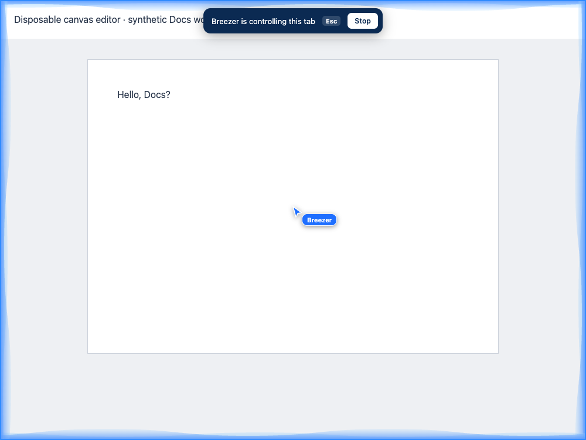

# Google Docs control diagnosis

## What is verified

A disposable, entirely synthetic editor reproduces a failure in Breezer's shipped browser-control path. It has a visible canvas, a transparent document hit layer, and an off-screen same-origin iframe whose contenteditable body receives trusted input. Playwright intercepts every request. No Google document, account, credentials or personal browser profile is used.

The unchanged fixture run against `98f8bdee` fails after authorization and screenshot capture with:

```text
Error: This element is covered or outside the visible page.
```

The old snapshot exposes the canvas under the hit layer. Target resolution rejects the covered canvas. The old typing path also requires a visible top-document editable field and always selects its entire contents. It cannot insert arbitrary ordinary text at the editor frame's caret. Its keyboard focus check examines only the outer document.

These are confirmed source/fixture gaps. Without a reproduction from the reported session, they are not a confirmed diagnosis of the user's authenticated Google Docs failure. Google's [canvas-rendering announcement](https://workspaceupdates.googleblog.com/2021/05/Google-Docs-Canvas-Based-Rendering-Update.html) documents the rendering change, but does not guarantee today's private editor DOM or its handling of text input.

## Change

A recognized `.kix-appview-editor` containing a canvas becomes one snapshot target on `https://docs.google.com/document/d/<id>/edit`, including account-indexed `/document/u/<n>/d/<id>/edit` URLs. Its hit layer accepts bounded tab-local clicks. A successful click binds only the focused `.docs-texteventtarget-iframe`, accessed through Chromium's same-origin DOM rules.

`browser_type` with `mode: "insert"` validates the latest target ID and the exact URL/editor/frame/document/focused element before using [DevTools Input.insertText](https://chromedevtools.github.io/devtools-protocol/tot/Input/#method-insertText). It preserves the caret and selection. Replacement typing remains the default for ordinary fields. Shift is limited to navigation-key presses; no general modifier shortcuts, scripts, selectors, frame IDs or cross-origin sessions are exposed to the provider.

The focus binding is checked again before input. Secret-field recognition applies to the input and its ancestors. Escape is attached to the bound input document and removed on Stop. Detached frames, replacement documents, cross-origin frames and URL/focus changes refuse input. Visible embedded frames are covered during screenshot capture rather than exposing fields the top-document redactor cannot inspect.

Native authorization, per-request/tab/window consent, provider isolation, cancellation and research's text-only/no-control permission path are unchanged. Both provider adapters exercise the new arguments through the existing host/worker action loop using transport fixtures.

## Repeatable checks

```sh
npm ci --ignore-scripts --prefix tests/ai
node --test tests/ai/docs-editor.test.mjs tests/ai/browser-tools.test.mjs tests/ai/browser-input-providers.test.mjs tests/ai/host.test.mjs tests/ai/research.test.mjs tests/ai/research-providers.test.mjs
node tests/ai/docs-editor-browser.mjs
node tests/ai/browser-page.mjs
```

The editor browser check asserts capture, hit-layer clicks, `Hello, Docs!` insertion, Shift-arrow selection, follow-up replacement to `Hello, Docs?`, trusted input, stale handle rejection, secrets, detached/navigated/cross-origin frames, site scoping, a late focus change, cancellation and frame Escape cleanup. CI runs it and uploads the fixture image.



`BREEZER_CONTROL_MODULE` can point to a historical browser-tools module, with its matching page-context import beside it, to rerun the same fixture against the old implementation. `BREEZER_TEST_BROWSER` selects a disposable test executable; Playwright creates a temporary profile. Never point this check at the installed Breezer profile.

## Required release acceptance

No verified disposable compiled Breezer app or authenticated disposable Docs profile was available for this work. The coordinator has kept prepared source and build outputs frozen. No native build, app installation, personal-profile use or real provider inference was performed.

Before describing this as an accepted Google Docs fix, use the combined compiled build in a disposable profile and a new disposable document. Verify both providers can focus the real document, insert ordinary text, navigate/select and perform a second editing request with existing tab consent. Confirm the site saves the changes. Exercise sidebar/page Stop, frame Escape, switching tabs/windows, reconnect/follow-up lifecycle and navigation cancellation. Capture only synthetic document contents and redacted stage errors. Verify ordinary controls and selected-tab research remain separate. Today's Docs markup and whether it consumes `Input.insertText` remain unverified until that check passes.
