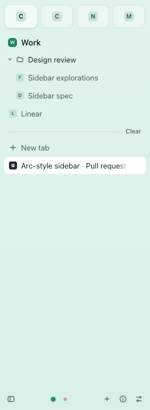

# Numbered favorite shortcuts

This is source and browser-fixture evidence, not compiled Breezer acceptance.
No verified disposable compiled app was available. The coordinator's frozen PC
build excludes this change. No installed app, personal profile, prepared source
or shared build cache was used or changed.

## Reproduction and result

Before the fix:

```text
node --test --test-name-pattern='numbered favorite command' tests/ai/workspace-browser.test.mjs
FAIL: Command+1 must handle the saved favorite, not native live index 0
false !== true
```

The minimal fixture has an unloaded first favorite and one ordinary live tab.
The native source selected the ordinary live tab at index 0, with no route to
the saved favorite. The same fixture now passes. Three numbered-command tests
cover lazy opening, no preload, open/discarded target reuse, rapid command and
click repetition while creation is held, failure/retry, favorites reordered
across spaces and restart, closed-folder and unloaded pins, invalid/missing
slots, the Command+9 boundary, input focus and two windows.

The browser fixture uses disposable headless Chrome contexts and a separate
isolated JavaScript world to replay the native host's cancelable DOM command.
It proves that the shipped sidebar handles that cross-world event and returns
handled/unhandled correctly. It does not prove that a physical key reached
Chromium. The screenshot below shows the opened first favorite in the fixture.
The example sites, tabs and storage are synthetic.



## Native source trace

Pinned Chromium 156.0.8078.47 plus the repository's pinned Helium patches:

1. `chrome/browser/global_keyboard_shortcuts_mac.mm`: Command+1..8 and their
   keypad equivalents map to `IDC_SELECT_TAB_0..7`; Command+9 maps to
   `IDC_SELECT_LAST_TAB`. Helium's customizable shortcut service retains these
   command IDs for reassigned accelerators.
2. macOS `CommandDispatcher` sends the command through
   `BrowserNativeWidgetMac::WillExecuteCommand` / `ExecuteCommand`. Reserved
   commands run before the first responder. `BrowserView::PreHandleKeyboardEvent`
   also consults `IsReservedCommandOrKey` on other desktop platforms. The overlay
   reserves only numbered browser commands for an available custom sidebar,
   within Chromium's existing app/fullscreen/edit-command policy.
3. `BrowserCommandController` offers `IDC_SELECT_TAB_0..7` to the originating
   browser's `BreezerWorkspaceView` before selecting a native tab index. Top tabs,
   private windows and a missing host retain the direct native route.
4. The host validates its live component-extension frame and runs a cancelable
   `breezer-select-numbered-tab` event there in Chrome's internal isolated world.
   The sidebar cancels only indices with a saved favorite or active-space pin.
   Both shortcut and tile activation share the per-entry pending creation.
5. An unhandled event returns to `chrome::SelectNumberedTab` directly, preserving
   native selectable-tab/group filtering without reentering the command hook.
   The callback uses the host's weak lifetime and original browser and gesture.
   `IDC_SELECT_LAST_TAB` remains unchanged.

`python3 -B script/check_breezer_workspace.py --no-cache` checks these source
contracts, pinned overlay application, idempotence, interrupted application and
anchor drift in temporary storage. It does not compile the new C++ code.

## Required combined-build acceptance

Use a disposable compiled Breezer with a new temporary profile and local fixture
pages. Do not use the installed browser or any personal profile.

- Save an unloaded favorite before an ordinary live tab. Press physical
  Command+1 with focus in page content, a page input, a sidebar tile and a sidebar
  rename field. Only the favorite should open. Plain number typing must remain
  input. Include a page that cancels its keydown events.
- Hold/repeat Command+1 during creation, then press it again with the target
  loaded and discarded. There must be exactly one live target in that window.
- Save several favorites and pins, including a closed folder. Check slots
  1..8, drag reorder, switch spaces and restart with some favorites unopened.
- Open two browser windows with different active spaces and a matching favorite
  already live in only one. The key must operate on the focused window, reusing
  its own live target rather than switching windows or borrowing the other's ID.
- Check Command+9's last-native-tab behavior, missing-slot native fallback,
  top-tab layout, private windows, extension-unavailable fallback, custom
  accelerator assignments, auto-hide sidebar and Chromium fullscreen policy.
- Capture a native recording and record the combined build SHA and results
  before describing physical keyboard behavior as accepted for 1.2.0.

Code and tests were written by gpt-6.1-sol. No other model contributed code.

## Local checks

- `node --test tests/ai/workspace*.test.mjs`: 32 passed, no skips.
- `python3 -B script/check_breezer_workspace.py --no-cache`: passed on the pinned
  Chromium/Helium fixture, including the dispatch contracts above.
- AI packaging, overlay boundary and preparation fingerprint checks: passed.
- `node --check features/ai/extension/workspace.js` and `git diff --check`: passed.
- `node --test tests/*.test.mjs tests/ai/*.test.mjs`: 282 passed, one opt-in live
  test skipped, one pre-existing visual-polish failure. The failing
  `new-tab sites keep equal slots and icon spacing whatever the title length`
  assertion reports `wide-dark-tide: visible sites`, `9 !== 8`. An isolated rerun
  fails identically on untouched `origin/main` 98f8bdee archived into a temporary
  fixture. No new-tab implementation or visual test was changed here.
