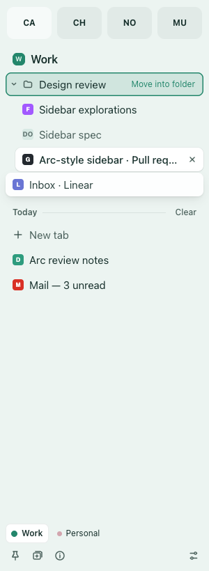

# Tab groups and folder drops

The workspace browser test reproduces the old failure before the fix: hovering a folder throws while looking up `node.folder.id` in the raw stored pinned nodes. Folder rows never become valid targets. The same test passes after using the rendered model's nodes. The target also accepts pages five pixels from its top edge, opens a closed destination after the drop, and preserves its membership after reload. Escape cancels a subsequent drag.

This is the actual shipped sidebar HTML and CSS in headless Google Chrome with deterministic `chrome.*` APIs. It is not a native Breezer screenshot. The screenshot shows the second drop, moving a saved pin into the now-open folder.

Verified in this worktree:

- All 11 workspace browser tests passed, including existing tab reorder and Favorites drops.
- All 21 workspace store/static tests passed.
- All 11 preparation tests passed.
- The broader Node suite passed 527 tests with 30 environment-dependent skips. The actual sidebar browser suite was run separately without skips.
- All nine changed/new native C++ translation units passed syntax checks against the prepared Chromium headers and generated files. The check used the recorded target compiler flags with the available Xcode SDK and a temporary VFS overlay, without changing the shared source tree or build outputs.
- The four modified GN build files passed the native GN parser.
- The workspace overlay applies to the pinned Chromium/Helium fixture, repeats without changes, repairs interrupted application, and rejects anchor drift before writes.

Native C++ syntax is verified; linking and native runtime behavior remain unverified. Before 1.2.6 publication, rebuild the combined native workspace overlay using a separate prepared tree or the repository's verified migration workflow. Preserve existing compiled caches. Run `browser_tests --gtest_filter=BreezerTabGroupColorBrowserTest.*`, then verify the New group button, stock/custom colour switching, RGB and hex input, keyboard focus, black/white contrast, window moves, saved-group reopening and browser restart in the actual app. The native tests cover RGB storage/reset and session ID remapping; they do not prove the entire UI or restart path.

The installed app and user profile were not changed. Release versioning and update-page notes belong to the combined 1.2.6 release thread.

Source review passed after two rounds with GPT-6.1 Sol on high reasoning. S1 fixed the RGB initializer type; S2 added the stock-colour fallback for controllers without a browser. Additional compiler checks found and verified fixes for S3, view metadata, and S4, browser-test interface accessors. No findings were declined. Review token usage was not returned. This approval covers source only, not linking, runtime or release acceptance.
