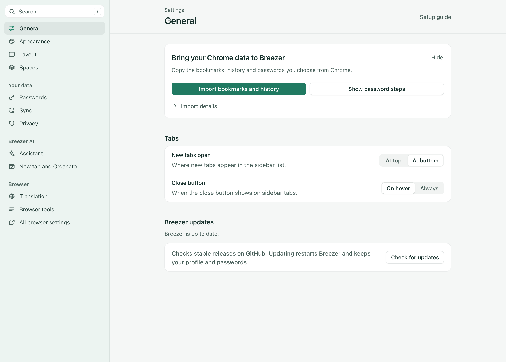
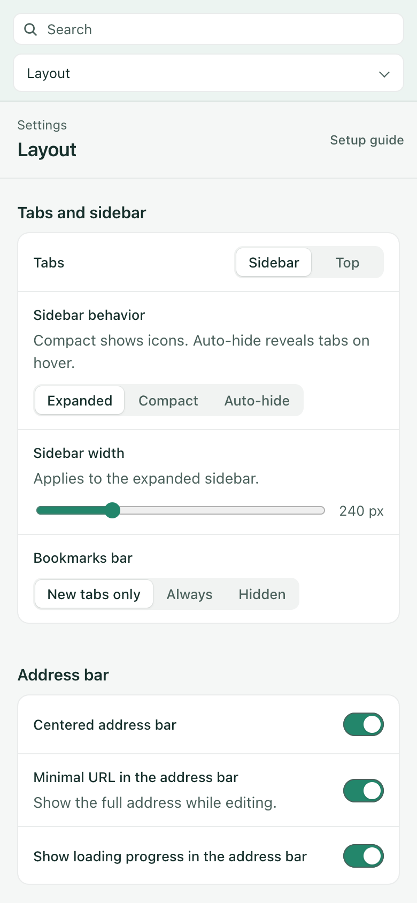

# 1.2.6 source integration checks

This source port starts from main `55b86e3b` and preserves the shipped PR17 UI and PR18 attachments. It brings together sidebar work reductions, persistent account-bound Organato caching, bounded helper/stream handling, reproducible filter overlays and opt-in saved-frame tooling. Release metadata remains 1.2.5 pending separate combined release preparation.

The integrated main-based app has not been built or benchmarked. Native compilation, packaged connected-account/chat behavior and the performance requirements remain open. The installed app and release assets are unchanged. Cancelled or superseded chat work cannot disconnect the helper serving a replacement chat; four deterministic regression cases cover late capture/query success and failure.

Local checks on Node 24.22.1 pass 868 tests with zero failures and two explicit skips. The skips are an opt-in live translation-server check and comparison with an absent local historical report. Another 48 filter-overlay tests, 16 header checks with nine negative controls, the separate panel/research/browser-control/editor/passkey/password-baseline checks and nine website tests pass. Packaging, native source overlays, actual GRIT resource packing, 16 saved-frame preparation fixtures, five resource-boundary tests and nine build-profile tests pass.

One unchanged imported Helium test is not portable to this Mac: it expects `/bin/false`, while macOS supplies `/usr/bin/false`. The other seven imported tests and both upstream configuration checks pass. The pinned vendor code and system paths were left unchanged; Linux CI remains required. Source checks and ordinary Chrome fixtures do not prove native Breezer behavior.

## Retained private-package comparison

These are the descriptive medians from eight completed balanced trials of an earlier frozen private package. They do not measure this main-based source port. The package included experimental native outline strips and saved-frame budget1, and used a restricted diagnostic host. It predates the final privacy fixes. One of eight required medians met its ceiling; seven missed. No release or merge clearance follows.

| Metric | Chrome | Private Breezer | Ratio | Required ceiling |
| --- | ---: | ---: | ---: | ---: |
| Startup (ms) | 746.162063 | 796.946687 | 1.068061 | 1 |
| Early navigation (ms) | 41.033563 | 73.433313 | 1.789591 | 1 |
| Tab switching (ms) | 37.923750 | 37.747521 | 0.995353 | 1 |
| Warm navigation (ms) | 38.633021 | 43.610480 | 1.128839 | 1 |
| Blank tab (ms) | 47.925604 | 65.637312 | 1.369567 | 1 |
| One-tab footprint (MiB) | 428.459656 | 457.480316 | 1.067733 | context only |
| Ten-tab footprint (MiB) | 853.958862 | 732.730957 | 0.858040 | 0.8 |
| Idle CPU lower (CPU-s/s) | 0.026376718 | 0.037262129 | 1.412690 | context only |
| Idle CPU upper (CPU-s/s) | 0.026376795 | 0.037262245 | 1.412690 | 1 |
| Active CPU lower (CPU-s/s) | 0.371459226 | 0.546692748 | 1.471744 | context only |
| Active CPU upper (CPU-s/s) | 0.371462073 | 0.546697104 | 1.471744 | 1 |

Raw result SHA-256: `5b1311195c143fa7e35fe4a07f0dcebb060f8b49e780f381f7a22db510abec7b`. [Exact aggregate inputs](evidence/performance-1.2.6/current-main-port-20261115/historical-benchmark-summary.json) retain the metric values and source identities. Full raw records and failed attempts remain in the original local evidence checkout. CPU bounds cover sequential read timing for a stable observed process tree, not total accounting error or short-lived children. Four pairs do not establish equivalence or a causal benefit. The incomplete supplemental idle control does not replace the scored idle result.

## Rendered source check

The current-main Settings walkthrough uses ordinary Chrome with deterministic extension/native API fixtures. It exercises the actual integrated extension source, including deferred Settings styles, category navigation, themes and narrow layout. It does not open a real account or verify native hosting.

Code and integration: GPT-6.1 Sol in Codex through T3 Code. Claude Fable 5.2 and Claude Opus 5.5 supplied earlier research; Fable also reviewed the older frozen candidate.
